# Sơ đồ Activity — Hệ thống quản lý cửa hàng laptop

## 1. Phạm vi và quy ước

Tài liệu chọn **12 luồng nghiệp vụ chính**, tương ứng cách tổ chức bản `Sequence.md` cô đọng, phù hợp đồ án môn học. Các thao tác liên quan được lồng ghép; không cần một sơ đồ cho từng use case nhỏ. Mã UC dùng để liên hệ với `DoAn.docx`.

Mã sử dụng **Mermaid `flowchart TD` để biểu diễn luồng hoạt động**: nút tròn là bắt đầu/kết thúc, hình chữ nhật là hành động, hình thoi là quyết định và các cạnh có nhãn là điều kiện rẽ nhánh. Đây là cách biểu diễn activity bằng Mermaid, không phải cú pháp UML Activity bản địa. Không dùng thanh fork/join vì các luồng được chọn không có bằng chứng cần xử lý song song.

Trừ đăng nhập, tiền điều kiện là người dùng đã đăng nhập và mở được phân hệ. Nhân viên thao tác thay mặt khách hàng/nhà cung cấp. Các bước nạp biểu mẫu, kết nối CSDL và ánh xạ DTO được rút gọn; kết thúc một sơ đồ là kết thúc lần xử lý đang mô tả, không nhất thiết thoát ứng dụng. Các nhánh hủy đóng vai trò kết thúc hoặc trở về màn hình phù hợp, không mặc định hoàn tác dữ liệu đã ghi.

## 2. Danh sách sơ đồ

| Mã | Nghiệp vụ | Use case liên quan |
|---|---|---|
| AD01 | Đăng nhập | UC01 |
| AD02 | Quản lý sản phẩm | UC24, UC25, UC27 |
| AD03 | Quản lý sản phẩm của nhà cung cấp | UC12 |
| AD04 | Lập phiếu nhập | UC35 |
| AD05 | Hoàn thành phiếu nhập | UC64 |
| AD06 | Lập đơn bán hàng, khách hàng và khuyến mãi | UC41, UC15, UC42 |
| AD07 | Tra cứu tồn kho và serial | UC30, UC31 |
| AD08 | Tiếp nhận và cập nhật bảo hành | UC21, UC22 |
| AD09 | Quản lý chương trình khuyến mãi | UC50, UC51, UC53 |
| AD10 | Cấp và cập nhật tài khoản | UC55, UC56 |
| AD11 | Tạo vai trò và thiết lập quyền | UC72, UC59 |
| AD12 | Thống kê và xuất báo cáo | UC60, UC61, UC62 |

## 3. Mã Mermaid

### AD01. Đăng nhập

**Liên hệ:** UC01.

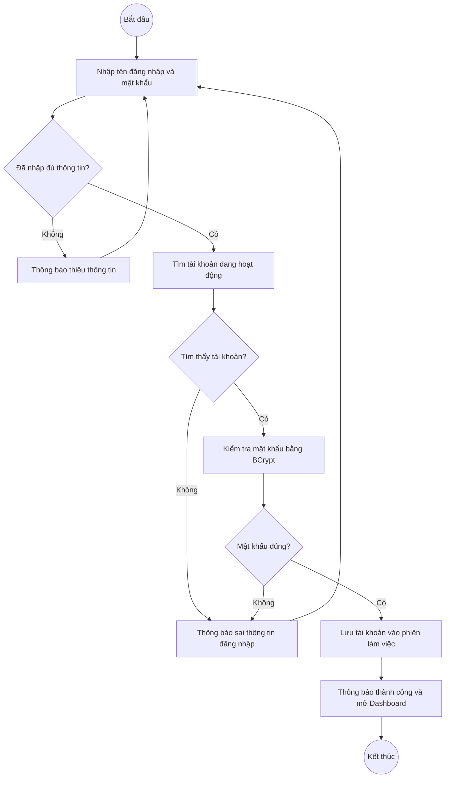

**Nguồn:** `GUI/JavaFX/LoginView.java`; `Bus/AccountBUS.java`; `DAO/AccountDAO.java`.

### AD02. Quản lý sản phẩm

**Liên hệ:** UC24, UC25, UC27.

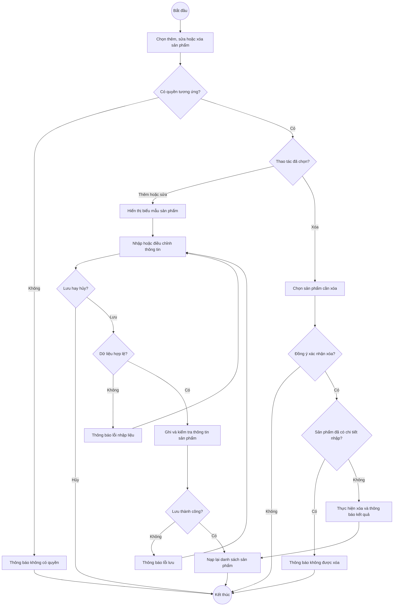

**Lưu ý:** Khi thêm, biểu mẫu còn cập nhật giá bán bằng JDBC sau khi tạo sản phẩm. Nếu một bước ghi lỗi, không mặc định toàn bộ thao tác đã rollback.

**Nguồn:** `GUI/JavaFX/ProductView.java`; `GUI/JavaFX/ProductEditDialogFx.java`; `DAO/SanPhamDAO.java`.

### AD03. Quản lý sản phẩm của nhà cung cấp

**Liên hệ:** UC12.

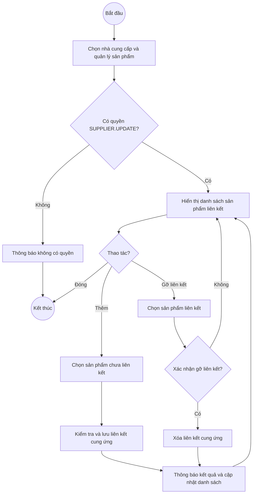

**Lưu ý:** Gỡ liên kết không xóa sản phẩm khỏi hệ thống và không tạo phiếu nhập.

**Nguồn:** `GUI/JavaFX/SupplierProductsDialogFx.java`; `Bus/supplierProductsBUS.java`; `DAO/supplierProductsDAO.java`.

### AD04. Lập phiếu nhập

**Liên hệ:** UC35.

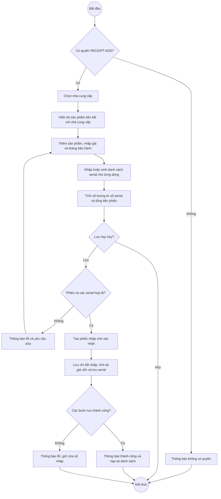

**Lưu ý:** Phiếu chờ chưa cộng stock bằng trigger hoàn thành. Các DAO ghi riêng; khi lỗi, một phần dữ liệu có thể đã lưu. Nút kết thúc ở nhánh lỗi kết thúc lần xử lý lưu, không có nghĩa đóng cửa sổ.

**Nguồn:** `GUI/JavaFX/ReceiptEditDialogFx.java`; `DAO/PhieuNhapDAO.java`; `DAO/ChiTietPhieuNhapDAO.java`; `DAO/SerialDAO.java`.

### AD05. Hoàn thành phiếu nhập

**Liên hệ:** UC64.

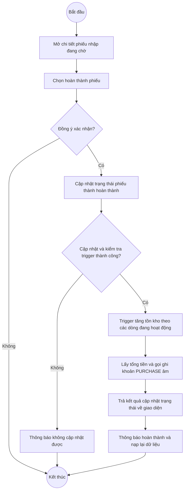

**Lưu ý:** Ghi khoản chi là lời gọi riêng. Code không kiểm tra kết quả boolean của bước này, nên giao diện vẫn có thể báo hoàn thành dù sổ quỹ ghi lỗi; không vẽ một nhánh cảnh báo mà chương trình chưa có.

**Nguồn:** `GUI/JavaFX/ReceiptDetailDialogFx.java`; `DAO/PhieuNhapDAO.java`; `DAO/CashLedgerDAO.java`; `data/sql.sql`.

### AD06. Lập đơn bán hàng, khách hàng và khuyến mãi

**Liên hệ:** UC41, UC15, UC42.

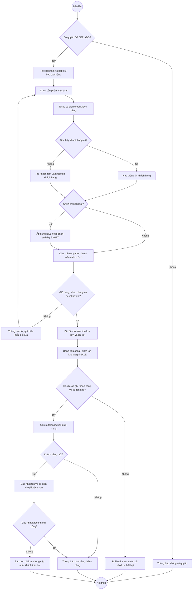

**Lưu ý:** PERCENT đã phản ánh trong giá sản phẩm. Cập nhật khách mới nằm sau commit; lỗi này không rollback đơn đã lưu. Sơ đồ tập trung vào nhánh lưu, lược bỏ việc parent dọn dữ liệu tạm khi đóng cửa sổ chưa hoàn tất.

**Nguồn:** `GUI/JavaFX/OrderCreateDialogFx.java`; `GUI/JavaFX/OrderView.java`; `DAO/OrderDAO.java`; `Bus/CustomerBUS.java`.

### AD07. Tra cứu tồn kho và serial

**Liên hệ:** UC30, UC31.

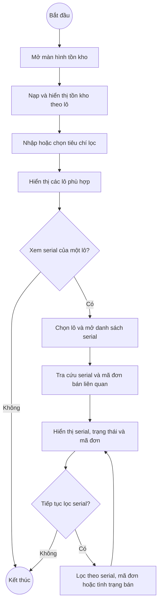

**Lưu ý:** Trong cửa sổ serial, nhãn Còn hàng/Đã bán được suy ra từ có hoặc không có mã đơn liên quan.

**Nguồn:** `GUI/JavaFX/InventoryView.java`; `GUI/JavaFX/SerialDetailDialogFx.java`; `DAO/khoDAO.java`; `DAO/SerialDAO.java`.

### AD08. Tiếp nhận và cập nhật bảo hành

**Liên hệ:** UC21, UC22.

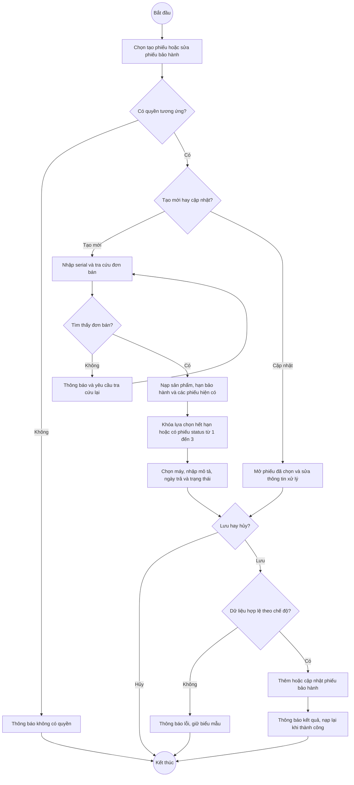

**Lưu ý:** Khi cập nhật, serial và sản phẩm được giữ cố định. Code có bốn trạng thái nhưng không ép thứ tự chuyển trạng thái; không thêm bước “đã trả khách” riêng.

**Nguồn:** `GUI/JavaFX/WarrantyEditDialogFx.java`; `GUI/JavaFX/WarrantyDetailDialogFx.java`; `DAO/warrantyCardDAO.java`.

### AD09. Quản lý chương trình khuyến mãi

**Liên hệ:** UC50, UC51, UC53.

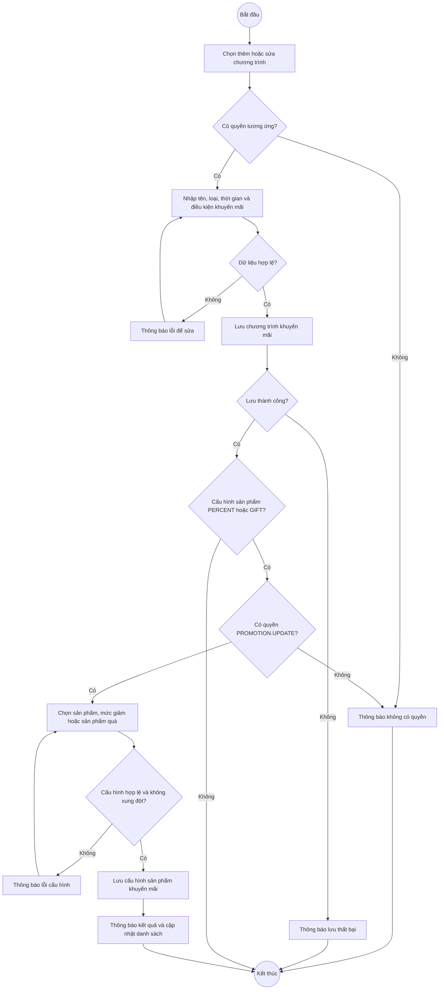

**Lưu ý:** BILL cấu hình giảm tổng hóa đơn; PERCENT/GIFT cấu hình thêm ở cấp sản phẩm. Hai lần lưu chương trình và cấu hình không được coi là một transaction chung.

**Nguồn:** `GUI/JavaFX/PromotionEditDialogFx.java`; `GUI/JavaFX/PromotionItemEditDialogFx.java`; `Bus/promotionsBUS.java`.

### AD10. Cấp và cập nhật tài khoản

**Liên hệ:** UC55, UC56.

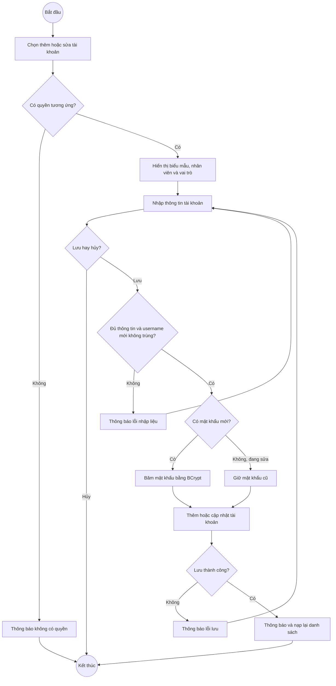

**Lưu ý:** Khi thêm bắt buộc có mật khẩu; khi sửa, username chỉ đọc và để trống mật khẩu sẽ giữ mật khẩu cũ. Chức năng sửa này không thay đổi trạng thái hoạt động.

**Nguồn:** `GUI/JavaFX/AccountEditDialogFx.java`; `DAO/AccountDAO.java`; `DTO/PasswordUtil.java`.

### AD11. Tạo vai trò và thiết lập quyền

**Liên hệ:** UC72, UC59.

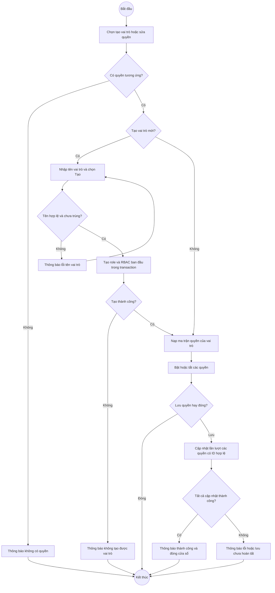

**Lưu ý:** Đóng sau khi tạo role không xóa role đã tạo. Lưu ma trận có thể thành công một phần và không tự tải lại mọi PermissionManager của phiên hiện tại.

**Nguồn:** `GUI/JavaFX/RolePermissionsDialogFx.java`; `DAO/RoleDAO.java`; `DAO/RolePermissionsDAO.java`.

### AD12. Thống kê và xuất báo cáo

**Liên hệ:** UC60, UC61, UC62.

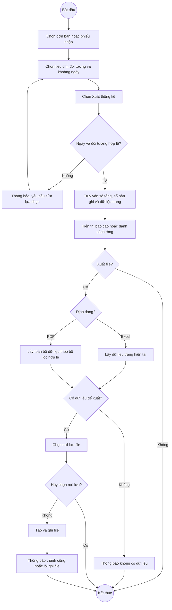

**Lưu ý:** Tiêu chí Nhân viên/Sản phẩm cần đối tượng cụ thể. Biểu đồ cơ cấu phương thức thanh toán chỉ hiển thị ở thống kê đơn bán với tiêu chí Tiền.

**Nguồn:** `GUI/JavaFX/StatisticsView.java`; `Bus/ThongKeBUS.java`; `DAO/ThongKeDAO.java`.

## 4. Ghi chú sử dụng

Các sơ đồ mô tả nghiệp vụ theo mã nguồn và phần phân tích đã thực hiện, không phải bằng chứng chạy thử. Nhánh lỗi chỉ biểu diễn ở mức cần thiết để hiểu luồng. Không tự bổ sung transaction, kiểm tra quyền hay bước xử lý mà chương trình chưa có. Khi đưa vào báo cáo, có thể kết xuất từng khối Mermaid và dùng tên AD01–AD12 làm tên hình.
